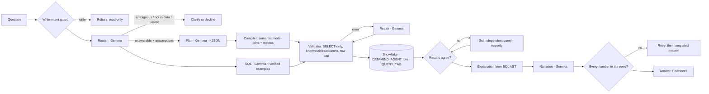

# DataMind — verified answers from your Snowflake data

[](https://github.com/Kanhaiya76618/datamind/actions/workflows/tests.yml) [](LICENSE)

Ask a question in plain English. DataMind answers it **by running SQL in Snowflake**, cross-checks the answer
with an independently generated second query, explains exactly what ran, and shows the query, the rows and
the Snowflake query id behind every number. When it can't be sure, it says so.

> ZeroDay OSS Hacktoberfest 2026 · Track PS1 "DataMind — Talk to Your Data" · Snowflake + Google Gemma

```
You:      Which 5 nations generated the most revenue from customers in ASIA in 1994?
DataMind: [answered · high confidence]
          VIETNAM led with 15,472,321.71 ... (each number highlighted: found in the result rows)
          Result | How it was computed | SQL & evidence (query id 01b8...) | Cross-check (2 of 2 queries agree)
```

## Why you can trust an answer

| Risk in "chat with your data" tools | What DataMind does |
|---|---|
| The model invents joins or metric formulas | Gemma picks *what* to compute as a JSON plan; **code** compiles it to SQL using only the joins and metric formulas written in the [semantic model](config/datasets/tpch.yaml). |
| Joins silently double count | The compiler only joins along many-to-one links from the coarsest possible table and **refuses** plans that would double count (e.g. average order value by part). |
| One wrong query looks just like a right one | Two independent queries (compiled plan + Gemma-written SQL) run for every question; identical results = high confidence. Disagreement triggers a third query and a majority vote, and the losing readings are shown. |
| The explanation describes something that didn't run | The "How it was computed" text is generated **from the executed SQL's syntax tree**, not by the model. |
| The written answer contains made-up numbers | Every number in Gemma's sentence is checked against the result rows (exact, rounded, millions/lakhs/crores, %, or a simple difference/ratio). Unverifiable numbers trigger a rewrite, then a templated answer built only from the rows. |
| The agent writes to or leaks data | Read-only Snowflake role, secondary roles disabled, a static validator that allows only one SELECT over the modelled tables, row cap, query timeout, write-intent guard. |
| Silent guessing on vague questions | A router classifies questions as answerable (with stated assumptions), ambiguous (asks, with one-click interpretations), not in the data, or unsafe. |

## Architecture



Gemma does the language work (routing, planning, writing SQL, repairing, narrating). Snowflake stores the
data and executes every query. Deterministic code sits between them and checks everything.
Details: [docs/ARCHITECTURE.md](docs/ARCHITECTURE.md).

## Quick start

Prerequisites: Python 3.11+, a Snowflake account (the free 30-day trial works — pick **Enterprise** edition at
sign-up), and a free Gemini API key from [Google AI Studio](https://aistudio.google.com/apikey) (or Ollama locally).

```bash
git clone <this repo> && cd datamind
python -m venv .venv && source .venv/bin/activate      # Windows: .venv\Scripts\activate
pip install -r requirements.txt
```

1. **Snowflake** — open a Snowsight SQL worksheet as ACCOUNTADMIN and run [`snowflake/01_setup.sql`](snowflake/01_setup.sql)
   top to bottom (about 2 minutes). It creates an X-Small warehouse with auto-suspend and a daily credit cap,
   three roles, the `DATAMIND_DB.TPCH` schema (copied from Snowflake's TPC-H sample data), masking policies and read-only grants.
   Optionally create the dedicated `DATAMIND_APP` user (section 7 of the script).
2. **Configure** — `cp .env.example .env` and fill in `SNOWFLAKE_ACCOUNT`, `SNOWFLAKE_USER`, `SNOWFLAKE_PASSWORD`
   (or a key file) and `GEMINI_API_KEY`.
3. **Check** — `python -m datamind check` runs one query in Snowflake and one Gemma call.
4. **Run the app** — `streamlit run app/streamlit_app.py`
5. **Or the CLI** — `python -m datamind ask "What was revenue by customer region in 1996?"`

Local Gemma instead of the API: install [Ollama](https://ollama.com), `ollama pull gemma4:26b` (about 18 GB download;
needs ~16 GB RAM, or use `gemma4:12b`), then set `GEMMA_BACKEND=ollama` and `GEMMA_MODEL=gemma4:26b`.

### Configuration

| Variable | Default | Meaning |
|---|---|---|
| `SNOWFLAKE_*` | see `.env.example` | connection; role defaults to the read-only `DATAMIND_AGENT` |
| `GEMMA_BACKEND` | `api` | `api` (Gemini API) or `ollama` (local) |
| `GEMMA_MODEL` | `gemma-4-31b-it` | any Gemma model; non-Gemma names are rejected |
| `GEMMA_THINKING` | `1` | let Gemma reason before plans/SQL (slower, more accurate) |
| `DATAMIND_DATASET` | `config/datasets/tpch.yaml` | the semantic model to use |
| `DATAMIND_ENGINE` | `snowflake` | `duckdb` = offline development only |
| `DATAMIND_MAX_ROWS` | `1000` | row cap per query |

Troubleshooting: `python -m datamind check` prints which side failed. "Insufficient privileges" → re-run the
setup script. Gemini `429` → free-tier rate limit; responses are cached in `.cache/llm`, so re-runs are free —
wait a minute or switch to Ollama. "Object does not exist" → `SNOWFLAKE_DATABASE`/`SCHEMA` don't match the setup.

## Using it

- **Ask anything** about orders, customers, suppliers, parts, revenue, profit, shipping, delays, stock.
- **Follow-ups** work: "and in 1996?" is rewritten into a full question using the conversation.
- **Ambiguous questions** ("who are our best customers?") get one-click interpretations.
- **Answer as** *Analyst* or *Restricted* (sidebar): the restricted role sees customer phone numbers and balances
  masked by a Snowflake masking policy, and DataMind says so.
- **Evidence**: each answer has the result table (cells that support the answer are highlighted), the plain-English
  computation, the SQL with Snowflake query id and answer id, a JSON evidence download, and the cross-check of all
  candidate queries.
- **Answer changes when data changes**: [`snowflake/02_demo_data_change.sql`](snowflake/02_demo_data_change.sql)
  inserts an order, the same question gets a new answer with a new query id, Time Travel shows before/after, then it reverts.
- **Trace in Snowflake**: [`snowflake/03_evidence_queries.sql`](snowflake/03_evidence_queries.sql) lists every DataMind
  query by answer id (via `QUERY_TAG`) and the warehouse's credit usage.

## How Snowflake is used

Snowflake is the system of record and the only place answers are computed: data lives in `DATAMIND_DB.TPCH`,
every candidate query runs on the `DATAMIND_WH` warehouse, and the result rows shown are exactly what Snowflake
returned. Governance and cost are handled in Snowflake itself: least-privilege roles (`DATAMIND_AGENT` has SELECT
only; secondary roles are disabled per session), a masking policy for PII on a restricted role, `QUERY_TAG` on every
query for traceability, a statement timeout, X-Small warehouse with 60-second auto-suspend, and a resource monitor
that suspends the warehouse at 4 credits/day. Time Travel (7-day retention) powers the before/after demo.
Cortex is not used: model inference is Gemma's job, kept separate from data storage and execution.

## How Gemma is used

Gemma 4 (default `gemma-4-31b-it` via the Gemini API; `gemma4:26b` via Ollama) performs the central AI tasks:
classifying and rewriting questions, producing structured query plans, writing and repairing Snowflake SQL, and
writing the final answer. Every Gemma output is validated before use (JSON schema for plans, the SQL validator and
Snowflake itself for SQL, the number checker for prose), and Gemma never executes anything. See
[`datamind/prompts.py`](datamind/prompts.py) and [`datamind/llm.py`](datamind/llm.py). Responses are cached on disk
(`.cache/llm`) so evaluation re-runs are reproducible.

## Evaluation

[`eval/tpch_dev.yaml`](eval/tpch_dev.yaml) holds 51 questions in 7 tiers (single table, joins, multi-step,
time, ambiguous, not-in-data, unsafe) with 36 paraphrases. Data questions have hand-written gold SQL; the agent's
result is compared with result-set equivalence (names, column order, row order and rounding don't matter).
Ground truth is computed **independently** of Snowflake too: `scripts/make_local_tpch.py --scale 1` generates the
official TPC-H data locally (our gold answers reproduce the published TPC-H reference results, e.g. Q3, Q5, Q14),
and `python -m datamind check-gold --independent duckdb` confirms Snowflake and the local engine agree.

```bash
python -m datamind check-gold --independent duckdb      # gold answers: Snowflake == independent engine
python -m datamind eval --paraphrases                   # score DataMind; writes eval/reports/eval_<time>.md
```

During evaluation the item being scored is excluded from the few-shot examples (leave-one-out). A separate
hold-out set ([template](eval/HOLDOUT_TEMPLATE.yaml)) is written by a teammate who never edits prompts.

**Results** — *fill in from `eval/reports/` after running with Gemma:*

| Tier | Accuracy |
|---|---|
| single_table | – |
| join | – |
| multi_step | – |
| time | – |
| ambiguous / not in data / unsafe | – |
| **hold-out (unseen)** | – |

## Tests

```bash
pip install -r requirements-dev.txt
python scripts/make_local_tpch.py --scale 0.01
python -m pytest -q          # 55 tests, ~6 s, fully offline
```

Tests cover the compiler (fan-out guard, role-playing tables, value normalisation), the SQL validator (writes,
other databases, system functions, misplaced/unknown columns), result comparison, number grounding, explanations,
the full pipeline with a scripted model (agreement, repair, tie-break, fallback narration, refusals, answer changing
when data changes), the evaluation harness (all gold SQL runs; a perfect model scores 100%), schema discovery,
and a Streamlit UI smoke test. CI runs them on every push.

## Adding another dataset

No code changes: describe the dataset in a YAML semantic model.

```bash
python -m datamind draft-model --schema MY_SCHEMA --name mydata --out config/datasets/mydata.yaml
# review the draft (descriptions, joins, metrics), then:
DATAMIND_DATASET=config/datasets/mydata.yaml streamlit run app/streamlit_app.py
```

The drafter reads `INFORMATION_SCHEMA`, finds small categorical columns and their values, and proposes
many-to-one joins only where the target key is actually unique. See [docs/ADDING_A_DATASET.md](docs/ADDING_A_DATASET.md).

## Data and licences

- **TPC-H** data comes from Snowflake's shared `SNOWFLAKE_SAMPLE_DATA.TPCH_SF1` and is copied only *inside your own
  Snowflake account* by the setup script. No data is committed to this repository. TPC-H is a synthetic benchmark
  dataset from the Transaction Processing Performance Council; it contains no real people or companies.
- Local test data is generated on your machine by [tpchgen-cli](https://github.com/clflushopt/tpchgen-rs) (Apache-2.0)
  and git-ignored.
- **Gemma** model weights and API use are governed by the licence on Google's official Gemma 4 model card — review it
  before use. On the Gemini API free tier, Google's terms may allow prompts to be used to improve its products; DataMind
  sends schema descriptions, questions and query results. For sensitive data, use the local Ollama backend.
- Code: [MIT](LICENSE).

## Known limitations

- Accuracy on unseen questions is high but not perfect; that is why every answer carries a confidence level,
  the cross-check, and the SQL. Low-confidence answers show the competing interpretations.
- Ratios between groups, rankings within groups and comparisons against an average are not expressible as plans;
  those rely on Gemma's SQL plus the cross-check (the plan path reports itself as "not expressible").
- The number checker accepts simple derived numbers (differences, ratios, shares, totals); a hallucinated number
  that coincidentally equals such a derivation would be marked "derived", not "verified". The UI shows which.
- The free Gemini API tier has low daily request caps; each question uses 4–8 Gemma calls. Caching and the Ollama backend help.
- One semantic model at a time per app instance; multi-dataset questions are out of scope.

## Main technical contribution

A **verification layer** for natural-language-to-SQL that makes a small team's agent trustworthy without a bigger model:
a semantic-model compiler with a double-counting guard, two independent query paths whose agreement is measured on
actual Snowflake results, explanations derived from the executed SQL's syntax tree, and number-level grounding of
the final prose — all evaluated against independently computed ground truth.

## Repository layout

```
app/streamlit_app.py       UI with evidence panel
config/datasets/*.yaml     semantic models (one per dataset)
datamind/                  pipeline, compiler, validator, checks, Gemma clients, executors, eval, discovery, CLI
eval/                      evaluation sets and reports
snowflake/                 setup, data-change demo, evidence queries, teardown
scripts/make_local_tpch.py local TPC-H generator for tests / independent gold
tests/                     55 offline tests
docs/                      architecture, demo script, adding a dataset, submission checklist
```

Contributions welcome — see [CONTRIBUTING.md](CONTRIBUTING.md), the [code of conduct](CODE_OF_CONDUCT.md) and the [security policy](SECURITY.md).
