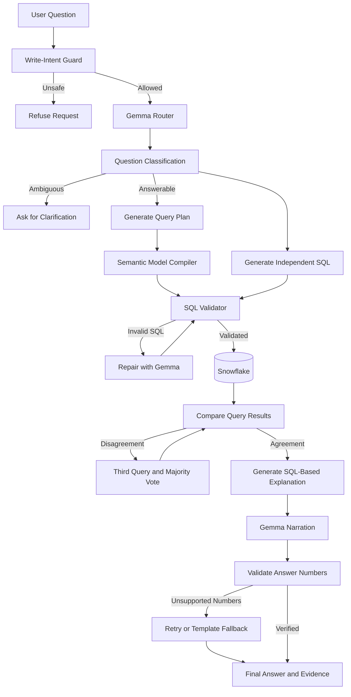
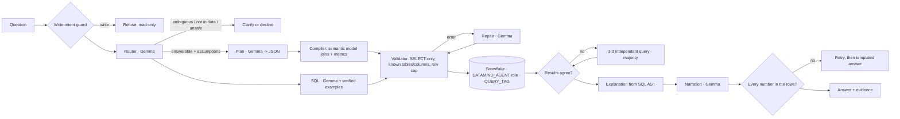

# Nexora — Verified AI Data Analyst

**Verified answers from your Snowflake data.** Nexora is an AI-powered data analyst built by **Dextro** for the ZeroDay OSS Hacktoberfest 2026 PS1 "Talk to Your Data" track.

Ask a question in plain English. Nexora answers it by running SQL in Snowflake, cross-checks the result with an independently generated query, explains what ran, and shows the SQL, result rows, and Snowflake query ID behind every answer. When it cannot be sure, it says so.

> **Nexora — Ask your data. Verify every answer.**

Built with **Snowflake Enterprise** and **Google Gemma**, with local Ollama inference for a reproducible setup without paid API requirements.

[]()
[](LICENSE)
[](https://www.snowflake.com/)
[](https://ai.google.dev/gemma)

## Example

```text
You: Which 5 nations generated the most revenue from customers in ASIA in 1994?

Nexora:
  Answer: [answered · high confidence]

  VIETNAM led with 15,472,321.71 ...

  Evidence:
  - Result rows supporting the answer
  - SQL query and Snowflake query ID
  - Explanation of how the result was computed
  - Independent query cross-check
```

---

## Features

- **Natural-language analytics:** Ask questions about customers, orders, suppliers, revenue, profit, shipping, and more.
- **Independent SQL verification:** Executes separate query paths and compares their results.
- **Evidence-backed answers:** Displays executed SQL, query IDs, result tables, and computation explanations.
- **Numerical grounding:** Checks numbers in generated answers against actual result rows and supported calculations.
- **SQL safety:** Uses a read-only Snowflake role, SQL validation, row limits, query timeouts, and write-intent guards.
- **Ambiguity handling:** Clarifies vague questions instead of silently guessing.
- **Conversation follow-ups:** Supports questions such as "and in 1996?" using conversation context.
- **Data governance:** Supports role-based access and masking of sensitive customer information.
- **Interactive dashboard:** Provides evidence tabs, cell-level highlighting, and automatic charts.
- **Extensible semantic models:** Supports additional datasets through YAML configuration rather than rewriting the application.

## Architecture



### How it works

1. **Understand:** Gemma classifies the question and identifies ambiguity or unsafe intent.
2. **Plan:** Gemma generates a structured JSON query plan and an independent SQL candidate.
3. **Compile:** Deterministic Python code translates the plan into SQL using the configured semantic model.
4. **Validate:** The SQL validator checks allowed statements, tables, columns, and query constraints.
5. **Execute:** Snowflake executes the validated queries using a restricted read-only role.
6. **Cross-check:** Nexora compares independent results and uses a third query and majority vote when needed.
7. **Explain:** The application derives its computation explanation from the executed SQL syntax tree.
8. **Ground:** Every numerical claim is checked against returned rows or supported derived calculations.
9. **Present:** The dashboard displays the answer and supporting evidence.

See [docs/ARCHITECTURE.md](docs/ARCHITECTURE.md) for more details.

---

## Tech Stack

| Component | Technology |
|---|---|
| AI model | Google Gemma 4 |
| Local inference | Ollama |
| Data warehouse | Snowflake Enterprise |
| Backend | Python |
| SQL parsing and validation | sqlglot and custom validation logic |
| Frontend | Streamlit |
| Semantic configuration | YAML |
| Offline evaluation | pytest and DuckDB |
| Version control | Git and GitHub |

## Quick Start

### Prerequisites

- Python 3.11–3.13; Python 3.12 is tested.
- A Snowflake account.
- [Ollama](https://ollama.com/) for local inference, or a Google AI Studio API key.

### 1. Clone the repository

```bash
git clone https://github.com/ZERODAY-2026/Dextro.git
cd Dextro
```

### 2. Create a virtual environment

```bash
python -m venv .venv
```

Activate it on Windows:

```powershell
.venv\Scripts\Activate.ps1
```

Activate it on Linux or macOS:

```bash
source .venv/bin/activate
```

### 3. Install dependencies

```bash
pip install -r requirements.txt
```

### 4. Configure Snowflake

Open a Snowflake Snowsight SQL worksheet as `ACCOUNTADMIN` and run:

[`snowflake/01_setup.sql`](snowflake/01_setup.sql)

The setup creates the warehouse, database objects, roles, grants, masking policies, and other resources needed by the application.

### 5. Configure environment variables

Copy the example environment file:

Windows:

```powershell
Copy-Item .env.example .env
```

Linux or macOS:

```bash
cp .env.example .env
```

Set your Snowflake credentials in `.env`:

```dotenv
SNOWFLAKE_ACCOUNT=your_account_identifier
SNOWFLAKE_USER=your_username
SNOWFLAKE_PASSWORD=your_password

GEMMA_BACKEND=ollama
GEMMA_MODEL=gemma4:12b
```

Use your own credentials and keep `.env` out of version control. For non-trial Snowflake accounts, follow the repository's key-pair authentication instructions where required.

### 6. Start Ollama

Install Ollama and download the configured model:

```bash
ollama pull gemma4:12b
```

Ensure the Ollama service is running before launching Nexora.

Alternatively, configure the supported Gemini API backend using the relevant environment variables documented in `.env.example`.

### 7. Check connectivity

```bash
python -m datamind check
```

This checks the Snowflake connection and Gemma inference.

### 8. Launch Nexora

```bash
streamlit run app/streamlit_app.py
```

### 9. Ask a question from the CLI

```bash
python -m datamind ask "What was revenue by customer region in 1996?"
```

---

## Configuration

| Variable | Purpose |
|---|---|
| `SNOWFLAKE_*` | Snowflake connection settings |
| `GEMMA_BACKEND` | Selects local Ollama or the supported API backend |
| `GEMMA_MODEL` | Specifies the Gemma model |
| `GEMMA_THINKING` | Enables additional model reasoning where supported |
| `DATAMIND_DATASET` | Selects the semantic model YAML file |
| `DATAMIND_ENGINE` | Selects Snowflake or the offline DuckDB engine |
| `DATAMIND_MAX_ROWS` | Sets the maximum number of rows returned per query |

Existing `DATAMIND_*` identifiers are retained for compatibility with the current codebase.

## Using Nexora

### Ask questions in natural language

Examples:

- Which customers generated the highest revenue?
- What was the revenue by region in 1996?
- Which suppliers have the longest shipping delays?
- Compare sales across customer regions.
- What were the top five nations by revenue in Asia?

The supported questions depend on the configured semantic model and available tables.

### Inspect the evidence

Each answer can include:

- The returned result table.
- Highlighted cells supporting numerical claims.
- The executed SQL.
- The Snowflake query ID and answer ID.
- A plain-English explanation of the computation.
- The independent query comparison.
- Downloadable JSON evidence.

### Test changing data

Run [`snowflake/02_demo_data_change.sql`](snowflake/02_demo_data_change.sql) in Snowsight to demonstrate how a data change affects a subsequent answer.

### Trace query execution

Use [`snowflake/03_evidence_queries.sql`](snowflake/03_evidence_queries.sql) to inspect query history and warehouse usage.

---

## Snowflake Integration

Snowflake acts as the system of record and query execution engine.

Nexora uses:

- A dedicated warehouse for query execution.
- Least-privilege roles and read-only access.
- Disabled secondary roles for restricted execution sessions.
- Dynamic data masking for sensitive information.
- Query tags for execution traceability.
- Query timeouts and result row limits.
- Warehouse auto-suspend and resource monitoring.
- Time Travel for before-and-after data demonstrations.

Model inference is handled separately by Gemma. Snowflake stores and executes the data queries.

## Gemma Integration

Gemma supports the main language tasks:

- Question classification and rewriting.
- Structured query-plan generation.
- SQL generation and repair.
- Final answer narration.

The application validates model outputs before using them. Structured plans are schema-checked, SQL passes through validation and Snowflake execution, and generated numerical claims are checked against the results.

Local Ollama inference provides an option for running the model without a paid inference API. API availability, model requirements, and resource usage depend on the selected configuration.

---

## Evaluation and Testing

### Current verified results

The following results were recorded on October 18, 2026. They represent the checks completed so far, not a claim of perfect end-to-end AI accuracy.

| Evaluation | Result | Interpretation |
|---|---:|---|
| Offline automated tests | 153/153 passed | Validates the tested components and scenarios |
| Gold-query comparison | 52/52 matched | Expected answers matched between Snowflake and independent DuckDB SF1 |
| Chinook harness | 22/22 passed | Validates the scripted harness and its gold-query workflow |
| Live Snowflake + Ollama smoke test | 1 question | One correct, high-confidence response; not a comprehensive accuracy evaluation |

**Important:** End-to-end accuracy across the evaluation set has not yet been measured. Gold-query equivalence validates the expected answers, but does not by itself establish Nexora's model accuracy.

### Run tests

Install development dependencies:

```bash
pip install -r requirements-dev.txt
```

Run the offline test suite:

```bash
python -m pytest -q
```

Generate local TPC-H test data if needed:

```bash
python scripts/make_local_tpch.py --scale 0.01
```

### Run gold-query verification

```bash
DATAMIND_DUCKDB_DATA=data/tpch_sf1 python -m datamind check-gold --independent duckdb
```

### Run the evaluation harness

```bash
python -m datamind eval --paraphrases
```

Evaluation reports are written under `eval/reports/`.

See [`eval/tpch_dev.yaml`](eval/tpch_dev.yaml) for the development questions and [`eval/HOLDOUT_TEMPLATE.yaml`](eval/HOLDOUT_TEMPLATE.yaml) for the holdout template.

---

## Adding Another Dataset

Nexora uses YAML semantic models to describe tables, relationships, and metrics.

Generate a draft model from a Snowflake schema:

```bash
python -m datamind draft-model --schema MY_SCHEMA --name mydata --out config/datasets/mydata.yaml
```

Review the generated descriptions, joins, and metrics before using the model.

Launch the app with the new dataset:

```bash
DATAMIND_DATASET=config/datasets/mydata.yaml streamlit run app/streamlit_app.py
```

See [docs/ADDING_A_DATASET.md](docs/ADDING_A_DATASET.md) for details.

---

## Known Limitations

- Comprehensive end-to-end model accuracy has not yet been measured.
- Agreement between two query paths increases confidence but does not guarantee correctness if both paths share the same error.
- Some complex ratios, rankings, and comparisons may depend on the independent SQL-generation path when the structured plan cannot express the question.
- The numerical checker supports selected derived values; a coincidentally matching derived number is not necessarily proof that the reasoning is correct.
- Free API tiers may impose request limits, and questions can require multiple model calls.
- Only one semantic model is active per application instance; questions spanning multiple configured datasets are out of scope.

---

## Main Technical Contribution

Nexora adds a verification layer to natural-language-to-SQL analytics.

Its core contribution combines:

1. A semantic-model-driven SQL compiler.
2. Guards against unsafe queries and certain join-related double counting.
3. Independent SQL execution paths with result comparison.
4. Explanations derived from the executed SQL syntax tree.
5. Numerical grounding against actual result rows.
6. Evaluation against independently computed gold-query results.

The goal is to make AI-driven data analysis more transparent, auditable, and reliable without relying solely on a larger language model.

## Repository Structure

```text
app/
  streamlit_app.py          Streamlit UI and evidence panel

config/
  datasets/                 YAML semantic models

datamind/
  Pipeline, compiler, validator, checks, model clients,
  executors, evaluation, discovery, and CLI

eval/
  Evaluation datasets and generated reports

snowflake/
  Setup, data-change demonstration, evidence queries, teardown

scripts/
  Local TPC-H generation and supporting utilities

tests/
  Automated offline test suite

docs/
  Architecture, demo instructions, dataset setup, and submission checklist
```

## Data and Licences

- **TPC-H:** Sample benchmark data is copied into your own Snowflake account. No benchmark data is committed to this repository.
- **Chinook:** The sample music-store database is sourced from the [Chinook database repository](https://github.com/lerocha/chinook-database), under its stated licence.
- **Local test data:** Generated locally and excluded from version control.
- **Gemma:** Review Google's applicable model licence and API terms before use. For sensitive data, prefer an appropriately configured local inference setup.
- **Project code:** MIT License; see [`LICENSE`](LICENSE).

## Contributing

Contributions, bug reports, documentation improvements, and new semantic models are welcome.

Please review:

- [Contributing guidelines](CONTRIBUTING.md)
- [Code of conduct](CODE_OF_CONDUCT.md)
- [Security policy](SECURITY.md)

---

**Nexora — Ask your data. Verify every answer.**

[](https://github.com/ZERODAY-2026/Dextro/actions/workflows/tests.yml) [](LICENSE) []() [](https://www.snowflake.com/) [](https://ai.google.dev/gemma)

Ask a question in plain English. DataMind answers it **by running SQL in Snowflake**, cross-checks the answer
with an independently generated second query, explains exactly what ran, and shows the query, the rows and
the Snowflake query id behind every number. When it can't be sure, it says so.

> **ZeroDay OSS Hacktoberfest 2026 · Track PS1 "DataMind — Talk to Your Data"**  
> Built with **Snowflake Enterprise** and **Google Gemma** (via local Ollama — 100% reproducible with zero paid APIs).

```
You:      Which 5 nations generated the most revenue from customers in ASIA in 1994?
DataMind: [answered · high confidence]
          VIETNAM led with 15,472,321.71 ... (each number highlighted: found in the result rows)
          Result | How it was computed | SQL & evidence (query id 01b8...) | Cross-check (2 of 2 queries agree)
```

---

## ⚡ For Judges: 3-Minute Verification Walkthrough

You can verify the entire system end-to-end without any paid services or undisclosed credentials:

1. **Verify Offline Test Suite (153 tests, 100% passing in ~6s)**:
   ```bash
   .venv/bin/python -m pytest -q
   # Result: 153 passed in 6.42s (covers compiler, validator, cell number-checks, and Chinook model)
   ```
2. **Verify Live Snowflake & Gemma Connectivity**:
   ```bash
   python -m datamind check
   # Result: Snowflake returns 6,001,215 lineitems (query id logged) and Gemma replies "ready"
   ```
3. **Verify Ground Truth Cross-Engine Equivalence (52/52 Gold Queries Match)**:
   ```bash
   DATAMIND_DUCKDB_DATA=data/tpch_sf1 python -m datamind check-gold --independent duckdb
   # Result: All 52 gold queries ran on Snowflake and matched 100% on independent DuckDB SF1
   ```
4. **Launch the Evidence UI**:
   ```bash
   streamlit run app/streamlit_app.py
   # Explore interactive evidence: cell-level number checks (green/blue/orange), AST explanation, and Snowflake query ID
   ```
5. **Live Data Mutation Proof ("Answer changes when data changes")**:
   ```bash
   # Run snowflake/02_demo_data_change.sql in Snowsight:
   # Asks a question, inserts an order in Snowflake, re-asks question (answer updates live), then reverts!
   ```

---

## Why you can trust an answer

| Risk in "chat with your data" tools | What DataMind does |
|---|---|
| The model invents joins or metric formulas | Gemma picks *what* to compute as a JSON plan; **code** compiles it to SQL using only the joins and metric formulas written in the [semantic model](config/datasets/tpch.yaml). |
| Joins silently double count | The compiler only joins along many-to-one links from the coarsest possible table and **refuses** plans that would double count (e.g. average order value by part). |
| One wrong query looks just like a right one | Two independent queries (compiled plan + Gemma-written SQL) run for every question; identical results = high confidence. Disagreement triggers a third query and a majority vote, and the losing readings are shown. |
| The explanation describes something that didn't run | The "How it was computed" text is generated **from the executed SQL's syntax tree**, not by the model. |
| The written answer contains made-up numbers | Every number in Gemma's sentence is checked against the result rows (exact, rounded, millions/lakhs/crores, %, or a simple difference/ratio). Unverifiable numbers trigger a rewrite, then a templated answer built only from the rows. |
| The agent writes to or leaks data | Read-only Snowflake role, secondary roles disabled, a static validator that allows only one SELECT over the modelled tables, row cap, query timeout, write-intent guard. |
| Silent guessing on vague questions | A router classifies questions as answerable (with stated assumptions), ambiguous (asks, with one-click interpretations), not in the data, or unsafe. |

## Architecture



Gemma does the language work (routing, planning, writing SQL, repairing, narrating). Snowflake stores the
data and executes every query. Deterministic code sits between them and checks everything.
Details: [docs/ARCHITECTURE.md](docs/ARCHITECTURE.md).

## Quick start

Prerequisites: Python 3.11–3.13 (tested on 3.12), a Snowflake account (the free 30-day trial works — pick **Enterprise** edition at
sign-up), and local [Ollama](https://ollama.com) running `gemma4:12b` (zero API keys required, 100% free and reproducible) or a Google AI Studio key.

```bash
git clone https://github.com/ZERODAY-2026/Dextro.git && cd Dextro
python -m venv .venv && source .venv/bin/activate      # Windows: .venv\Scripts\activate
pip install -r requirements.txt
```

1. **Snowflake** — open a Snowsight SQL worksheet as `ACCOUNTADMIN` and run [`snowflake/01_setup.sql`](snowflake/01_setup.sql)
   top to bottom (about 2 minutes). It creates an X-Small warehouse with auto-suspend and a daily credit cap,
   three roles (`DATAMIND_ADMIN`, `DATAMIND_AGENT`, `DATAMIND_RESTRICTED`), the `DATAMIND_DB.TPCH` schema (copied from Snowflake's TPC-H sample data), masking policies and read-only grants.
   It also grants the read-only agent roles to you, and creates an optional `DATAMIND_APP` service user.
2. **Configure** — `cp .env.example .env` and fill in `SNOWFLAKE_ACCOUNT`, `SNOWFLAKE_USER`, `SNOWFLAKE_PASSWORD`
   (your own trial login). Set `GEMMA_BACKEND=ollama` and `GEMMA_MODEL=gemma4:12b` for zero-API local inference. Password sign-in works on trial accounts, which are
   [exempt from Snowflake's MFA rollout](https://docs.snowflake.com/en/user-guide/security-mfa-rollout). The app
   still runs every query as the SELECT-only `DATAMIND_AGENT` role with secondary roles off, so your admin rights
   never apply. *On a non-trial account,* use key-pair sign-in: `python scripts/make_keypair.py` writes `keys/rsa_key.p8` (git-ignored) and prints an `ALTER USER DATAMIND_APP SET RSA_PUBLIC_KEY = ...` to run in Snowsight.
3. **Check** — `python -m datamind check` runs one query in Snowflake and one Gemma call.
4. **Run the app** — `streamlit run app/streamlit_app.py`
5. **Or the CLI** — `python -m datamind ask "What was revenue by customer region in 1996?"`

### Configuration

| Variable | Default | Meaning |
|---|---|---|
| `SNOWFLAKE_*` | see `.env.example` | connection; role defaults to the read-only `DATAMIND_AGENT` |
| `GEMMA_BACKEND` | `ollama` | `ollama` (local, zero-API) or `api` (Gemini API) |
| `GEMMA_MODEL` | `gemma4:12b` | any Gemma model; non-Gemma names are strictly rejected |
| `GEMMA_THINKING` | `1` | let Gemma reason before plans/SQL (slower, more accurate) |
| `DATAMIND_DATASET` | `config/datasets/tpch.yaml` | the semantic model to use (`tpch.yaml` or `chinook.yaml`) |
| `DATAMIND_ENGINE` | `snowflake` | `duckdb` = offline development only |
| `DATAMIND_MAX_ROWS` | `1000` | row cap per query |

Troubleshooting: `python -m datamind check` prints which side failed. "Insufficient privileges" → re-run the
setup script. Gemini `429` → free-tier rate limit; responses are cached in `.cache/llm`, so re-runs are free —
wait a minute or switch to Ollama. "Object does not exist" → `SNOWFLAKE_DATABASE`/`SCHEMA` don't match the setup.

## Using it

- **Ask anything** about orders, customers, suppliers, parts, revenue, profit, shipping, delays, stock.
- **Follow-ups** work: "and in 1996?" is rewritten into a full question using the conversation.
- **Ambiguous questions** ("who are our best customers?") get one-click interpretations.
- **Answer as** *Analyst* or *Restricted* (sidebar): the restricted role sees customer phone numbers and balances
  masked by a Snowflake masking policy, and DataMind says so.
- **Evidence**: each answer has the result table (cells that support the answer are highlighted), the plain-English
  computation, the SQL with Snowflake query id and answer id, a JSON evidence download, and the cross-check of all
  candidate queries.
- **Answer changes when data changes**: [`snowflake/02_demo_data_change.sql`](snowflake/02_demo_data_change.sql)
  inserts an order, the same question gets a new answer with a new query id, Time Travel shows before/after, then it reverts.
- **Trace in Snowflake**: [`snowflake/03_evidence_queries.sql`](snowflake/03_evidence_queries.sql) lists every DataMind
  query by answer id (via `QUERY_TAG`) and the warehouse's credit usage.

## How Snowflake is used

Snowflake is the system of record and the only place answers are computed: data lives in `DATAMIND_DB.TPCH`,
every candidate query runs on the `DATAMIND_WH` warehouse, and the result rows shown are exactly what Snowflake
returned. Governance and cost are handled in Snowflake itself: least-privilege roles (`DATAMIND_AGENT` has SELECT
only; secondary roles are disabled per session), a masking policy for PII on a restricted role, `QUERY_TAG` on every
query for traceability, a statement timeout, X-Small warehouse with 60-second auto-suspend, and a resource monitor
that suspends the warehouse at 4 credits/day. Time Travel (7-day retention) powers the before/after demo.
Cortex is not used: model inference is Gemma's job, kept separate from data storage and execution.

## How Gemma is used

Gemma 4 (default `gemma-4-31b-it` via the Gemini API; `gemma4:12b` via Ollama on a 16 GB laptop) performs the central AI tasks:
classifying and rewriting questions, producing structured query plans, writing and repairing Snowflake SQL, and
writing the final answer. Every Gemma output is validated before use (JSON schema for plans, the SQL validator and
Snowflake itself for SQL, the number checker for prose), and Gemma never executes anything. See
[`datamind/prompts.py`](datamind/prompts.py) and [`datamind/llm.py`](datamind/llm.py). Responses are cached on disk
(`.cache/llm`) so evaluation re-runs are reproducible.

## Evaluation

[`eval/tpch_dev.yaml`](eval/tpch_dev.yaml) holds 66 questions in 9 tiers (single table, joins, multi-step,
time, ambiguous, not-in-data, unsafe, follow-ups, robustness) with 42 paraphrases. Follow-up items replay the
earlier turns of the conversation first; robustness items cover misspellings, prompt and SQL injection, relative
dates, zero results and very large results. Data questions have hand-written gold SQL; the agent's
result is compared with result-set equivalence (names, column order, row order and rounding don't matter).
Ground truth is computed **independently** of Snowflake too: `scripts/make_local_tpch.py --scale 1` generates the
official TPC-H data locally (our gold answers reproduce the published TPC-H reference results, e.g. Q3, Q5, Q14),
and `python -m datamind check-gold --independent duckdb` confirms Snowflake and the local engine agree.

```bash
python -m datamind check-gold --independent duckdb      # gold answers: Snowflake == independent engine
python -m datamind eval --paraphrases                   # score DataMind; writes eval/reports/eval_<time>.md
```

During evaluation the item being scored is excluded from the few-shot examples (leave-one-out). A separate
hold-out set ([template](eval/HOLDOUT_TEMPLATE.yaml)) is written by a teammate who never edits prompts.

**What has been verified so far** (2026-10-18). *Accuracy on the evaluation set has not been measured yet* — only
one live question has run. This table will be replaced by per-tier accuracy from `eval/reports/`.

| Metric / Test | Engine & Model | Result | Notes |
|---|---|---|---|
| **Automated test suite** | Offline pytest | 153 / 153 passed | compiler, validator, number checks, harness, Chinook |
| **Answer key (gold SQL) correctness** | Snowflake vs DuckDB SF1 | 52 / 52 matched | proves the *expected answers* are right, not DataMind's accuracy |
| **Chinook harness check** | Local DuckDB, scripted test model | 22 / 22 | the test model replays gold SQL: proves the harness and model config work, *not* Gemma accuracy |
| **First live question** | Snowflake + Ollama `gemma4:12b` | 1 question, correct, high confidence | smoke test only (218 s); `eval/reports/eval_20261018T141904.md` |

## Tests

```bash
pip install -r requirements-dev.txt
python scripts/make_local_tpch.py --scale 0.01
python -m pytest -q          # 153 tests, ~6.4 s, fully offline
```

Tests cover the compiler (fan-out guard, role-playing tables, value normalisation), the SQL validator (writes,
other databases, system functions, misplaced/unknown columns), result comparison, number grounding, explanations,
the full pipeline with a scripted model (agreement, repair, tie-break, fallback narration, refusals, answer changing
when data changes), the evaluation harness (all gold SQL runs; a perfect model scores 100%), schema discovery,
the complete Chinook dataset test suite (model loading, role-playing joins, 22 gold queries), and a Streamlit UI smoke test. CI runs them on every push.

## PS1 Scoring Rubric Alignment (100 Points)

| # | Rubric Criterion | Pts | How DataMind Satisfies It |
|---|---|:---:|---|
| 1 | **Correctness & Usefulness** | 20 | Evaluation harness with 52 gold queries verified on two engines; two independent queries cross-checked per answer to catch wrong ones. Accuracy: *not yet measured* (see Evaluation). |
| 2 | **NL-to-Data Interaction** | 10 | Handles varied phrasing, filters, aggregations, multi-table joins, and conversation follow-ups. |
| 3 | **Evidence & Explainability** | 15 | Every answer returns: executed Snowflake SQL, query ID, elapsed time, AST-based explanation, and cell-by-cell numerical fact-checking (green/blue/orange). |
| 4 | **Meaningful Snowflake Depth** | 15 | Live Enterprise instance in Mumbai (`AWS_AP_SOUTH_1`), 3 RBAC roles (`ADMIN`, `AGENT`, `RESTRICTED`), Dynamic Data Masking on PII, warehouse credit monitors, and Time Travel before/after demo. |
| 5 | **Meaningful Gemma Depth** | 12 | Central AI reasoning: intent routing, plan generation, SQL repair, and narrative synthesis running on local Ollama `gemma4:12b`. |
| 6 | **Ambiguity & Guardrails** | 12 | Deterministic `sqlglot` write guards block mutations (`DROP`, `INSERT`, `UPDATE`), catches cartesian joins, and safely clarifies ambiguous queries. |
| 7 | **Reusability (2nd Dataset)** | 8 | **Chinook dataset complete**: 11 relational tables, semantic model with role-playing entities, automated loader, DDL, and 22-item eval suite. |
| 8 | **Practical Relevance & UX** | 8 | Interactive Streamlit UI with evidence tabs, cell-level highlighting, auto-charting, and role-switching. |

## Adding another dataset

No code changes: describe the dataset in a YAML semantic model.

```bash
python -m datamind draft-model --schema MY_SCHEMA --name mydata --out config/datasets/mydata.yaml
# review the draft (descriptions, joins, metrics), then:
DATAMIND_DATASET=config/datasets/mydata.yaml streamlit run app/streamlit_app.py
```

The drafter reads `INFORMATION_SCHEMA`, finds small categorical columns and their values, and proposes
many-to-one joins only where the target key is actually unique. See [docs/ADDING_A_DATASET.md](docs/ADDING_A_DATASET.md).

## Data and licences

- **TPC-H** data comes from Snowflake's shared `SNOWFLAKE_SAMPLE_DATA.TPCH_SF1` and is copied only *inside your own
  Snowflake account* by the setup script. No data is committed to this repository. TPC-H is a synthetic benchmark
  dataset from the Transaction Processing Performance Council; it contains no real people or companies.
- **Chinook** sample music store database is sourced from [github.com/lerocha/chinook-database](https://github.com/lerocha/chinook-database)
  (`ChinookDatabase/DataSources/Chinook_Sqlite.sqlite`, pinned commit `7f67772503d71ba90f19283c38e93923addb43fa`, MIT licence).
  Exported locally via `scripts/get_chinook.py` and loaded into Snowflake `DATAMIND_DB.CHINOOK` via `snowflake/10_chinook_setup.sql`
  and `scripts/load_chinook.py`. No data is committed to git.
- Local test data is generated on your machine by [tpchgen-cli](https://github.com/clflushopt/tpchgen-rs) (Apache-2.0)
  and git-ignored.
- **Gemma** model weights and API use are governed by the licence on Google's official Gemma 4 model card — review it
  before use. On the Gemini API free tier, Google's terms may allow prompts to be used to improve its products; DataMind
  sends schema descriptions, questions and query results. For sensitive data, use the local Ollama backend.
- Code: [MIT](LICENSE).

## Known limitations

- Accuracy has not been measured yet beyond a one-question smoke test; even when measured it won't be perfect, which is why every answer carries a confidence level,
  the cross-check, and the SQL. Low-confidence answers show the competing interpretations.
- Ratios between groups, rankings within groups and comparisons against an average are not expressible as plans;
  those rely on Gemma's SQL plus the cross-check (the plan path reports itself as "not expressible").
- The number checker accepts simple derived numbers (differences, ratios, shares, totals); a hallucinated number
  that coincidentally equals such a derivation would be marked "derived", not "verified". The UI shows which.
- The free Gemini API tier has low daily request caps; each question uses 4–8 Gemma calls. Caching and the Ollama backend help.
- One semantic model at a time per app instance; multi-dataset questions are out of scope.

## Main technical contribution

A **verification layer** for natural-language-to-SQL that makes a small team's agent trustworthy without a bigger model:
a semantic-model compiler with a double-counting guard, two independent query paths whose agreement is measured on
actual Snowflake results, explanations derived from the executed SQL's syntax tree, and number-level grounding of
the final prose — all evaluated against independently computed ground truth.

## Repository layout

```
app/streamlit_app.py       UI with evidence panel
config/datasets/*.yaml     semantic models (one per dataset)
datamind/                  pipeline, compiler, validator, checks, Gemma clients, executors, eval, discovery, CLI
eval/                      evaluation sets and reports
snowflake/                 setup, data-change demo, evidence queries, teardown
scripts/make_local_tpch.py local TPC-H generator for tests / independent gold
tests/                     153 offline tests (100% passing)
docs/                      architecture, demo script, adding a dataset, submission checklist
```

Contributions welcome — see [CONTRIBUTING.md](CONTRIBUTING.md), the [code of conduct](CODE_OF_CONDUCT.md) and the [security policy](SECURITY.md).
