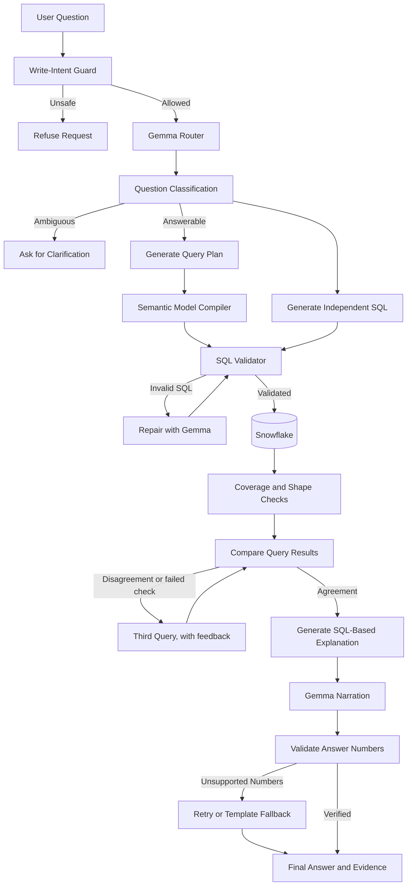

# Nexora — Verified AI Data Analyst

**Verified answers from your Snowflake data.** Nexora is an AI-powered data analyst built by **Dextro** for the ZeroDay OSS Hacktoberfest 2026 PS1 "Talk to Your Data" track.

Ask a question in plain English. Nexora answers it by running SQL in Snowflake, cross-checks the result with an independently generated query, explains what ran, and shows the SQL, result rows, and Snowflake query ID behind every answer. When it cannot be sure, it says so.

> **Nexora — Ask your data. Verify every answer.**

Built with **Snowflake Enterprise** and **Google Gemma**, with local Ollama inference for a reproducible setup without paid API requirements.

> **Names:** *Nexora* is the product, *Dextro* is the team and repository. The Python package and command line keep
> the original track name: `datamind` (for example `python -m datamind ask "..."`), and settings use `DATAMIND_*`.

[](https://github.com/ZERODAY-2026/Dextro/actions/workflows/tests.yml)
[](LICENSE)
[](https://www.snowflake.com/)
[](https://ai.google.dev/gemma)

## Example

```text
You: Which 5 nations generated the most revenue from customers in ASIA in 1994?

Nexora:
  Answer: [answered · high confidence]

  VIETNAM led with 15,472,321.71 ...

  Evidence:
  - Result rows supporting the answer
  - SQL query and Snowflake query ID
  - Explanation of how the result was computed
  - Independent query cross-check
```

---

## For Judges: Verification Walkthrough

Everything below runs on a free Snowflake trial and local Gemma (Ollama); no paid service or undisclosed credential
is needed. Setup steps are in [Quick Start](#quick-start).

1. **Offline test suite** (compiler, validator, checks, harness, Chinook, UI smoke test):
   ```bash
   python -m pytest -q
   ```
2. **Live Snowflake and Gemma connectivity** — runs one query in Snowflake and one Gemma call:
   ```bash
   python -m datamind check
   ```
3. **Ground truth is independent of Snowflake** — every gold query runs in Snowflake and on locally generated
   official TPC-H data (DuckDB), and the results must match:
   ```bash
   python scripts/make_local_tpch.py --scale 1
   DATAMIND_DUCKDB_DATA=data/tpch_sf1 python -m datamind check-gold --independent duckdb
   ```
4. **The evidence UI:**
   ```bash
   streamlit run app/streamlit_app.py
   ```
5. **Answer changes when data changes:** ask a question, run the steps in
   [`snowflake/02_demo_data_change.sql`](snowflake/02_demo_data_change.sql) (inserts an order, compares before/after
   with Time Travel, then reverts), and ask again: a new answer with a new Snowflake query ID.

## Why you can trust an answer

| Risk in "chat with your data" tools | What Nexora does |
|---|---|
| The model invents joins or metric formulas | Gemma picks *what* to compute as a JSON plan; **code** compiles it to SQL using only the joins and metric formulas written in the [semantic model](config/datasets/tpch.yaml). |
| Joins silently double count | The compiler only joins along many-to-one links from the coarsest possible table and **refuses** plans that would double count (e.g. average order value by part), including measures used only for filtering or sorting. |
| One wrong query looks just like a right one | Two independent queries (compiled plan + Gemma-written SQL) run for every question; identical results = high confidence. Disagreement triggers a third query and a majority vote, and the losing readings are shown. |
| Two queries agree on the same mistake (e.g. both drop "in 1995") | Deterministic coverage and shape checks ([`verify.py`](datamind/verify.py)): every year, threshold and known value in the question must appear in the executed SQL; "top 5" must return ≤ 5 rows; "how many" must return one row. A failing answer is never high confidence, the covering candidate wins, and one retry is generated with the exact problem. No correct gold answer is flagged (0 of 142 tested). |
| The explanation describes something that didn't run | The "How it was computed" text is generated **from the executed SQL's syntax tree**, not by the model. |
| The written answer contains made-up numbers | Every number in Gemma's sentence is checked against the result rows (exact, rounded, millions/lakhs/crores, %, or a simple difference/ratio). A number that appears only in the question doesn't count. Unverifiable numbers trigger a rewrite, then a templated answer built only from the rows. |
| The agent writes to or leaks data | Read-only Snowflake role, secondary roles disabled, a static validator that allows only one SELECT over the modelled tables (no table functions, no Cortex/AI functions, no cartesian joins), row cap, query timeout, write-intent guard. |
| Silent guessing on vague questions | A router classifies questions as answerable (with stated assumptions), ambiguous (asks, with one-click interpretations), not in the data, or unsafe. |

## Features

- **Natural-language analytics:** Ask questions about customers, orders, suppliers, revenue, profit, shipping, and more.
- **Independent SQL verification:** Executes separate query paths and compares their results.
- **Evidence-backed answers:** Displays executed SQL, query IDs, result tables, and computation explanations.
- **Numerical grounding:** Checks numbers in generated answers against actual result rows and supported calculations.
- **Coverage checks:** Confirms the executed query uses every year, threshold, and known value stated in the question.
- **SQL safety:** Uses a read-only Snowflake role, SQL validation, row limits, query timeouts, and write-intent guards.
- **Ambiguity handling:** Clarifies vague questions instead of silently guessing.
- **Conversation follow-ups:** Supports questions such as "and in 1996?" using conversation context.
- **Data governance:** Supports role-based access and masking of sensitive customer information.
- **Interactive dashboard:** Provides evidence tabs, cell-level highlighting, and automatic charts.
- **Extensible semantic models:** Supports additional datasets through YAML configuration rather than rewriting the application.

## Architecture



### How it works

1. **Understand:** Gemma classifies the question and identifies ambiguity or unsafe intent.
2. **Plan:** Gemma generates a structured JSON query plan and an independent SQL candidate.
3. **Compile:** Deterministic Python code translates the plan into SQL using the configured semantic model.
4. **Validate:** The SQL validator checks allowed statements, tables, columns, and query constraints.
5. **Execute:** Snowflake executes the validated queries using a restricted read-only role.
6. **Check coverage:** Each result is checked against the years, thresholds, values, and "top N" stated in the question.
7. **Cross-check:** Nexora compares independent results and uses a third query and majority vote when needed.
8. **Explain:** The application derives its computation explanation from the executed SQL syntax tree.
9. **Ground:** Every numerical claim is checked against returned rows or supported derived calculations.
10. **Present:** The dashboard displays the answer and supporting evidence.

Gemma does the language work; Snowflake stores the data and executes every query; deterministic code sits between
them and checks everything. See [docs/ARCHITECTURE.md](docs/ARCHITECTURE.md) for more details.

---

## Tech Stack

| Component | Technology |
|---|---|
| AI model | Google Gemma 4 |
| Inference | Ollama (local, default) or Hugging Face Inference Providers (Gemma 4 31B) |
| Data warehouse | Snowflake Enterprise |
| Backend | Python |
| SQL parsing and validation | sqlglot and custom validation logic |
| Frontend | Streamlit |
| Semantic configuration | YAML |
| Offline evaluation | pytest and DuckDB |
| Version control | Git and GitHub |

## Quick Start

### Prerequisites

- Python 3.11–3.13; Python 3.12 is tested (if your Mac ships 3.14, create the environment with `uv venv --python 3.12`).
- A Snowflake account; the free 30-day trial works — pick **Enterprise** edition at sign-up (needed for masking).
- Gemma, either:
  - [Ollama](https://ollama.com/) with `gemma4:12b` (local, free, fits a 16 GB laptop), or
  - Gemma 4 31B through [Hugging Face Inference Providers](https://huggingface.co/google/gemma-4-31B-it)
    (Hugging Face token with Inference Providers permission and credits).

### 1. Clone the repository

```bash
git clone https://github.com/ZERODAY-2026/Dextro.git
cd Dextro
```

### 2. Create a virtual environment

```bash
python -m venv .venv
```

Activate it on Windows:

```powershell
.venv\Scripts\Activate.ps1
```

Activate it on Linux or macOS:

```bash
source .venv/bin/activate
```

### 3. Install dependencies

```bash
pip install -r requirements.txt
```

### 4. Configure Snowflake

Open a Snowflake Snowsight SQL worksheet as `ACCOUNTADMIN` and run:

[`snowflake/01_setup.sql`](snowflake/01_setup.sql)

It takes about 2 minutes and creates an X-Small warehouse with auto-suspend and a daily credit cap, three roles
(`DATAMIND_ADMIN`, `DATAMIND_AGENT`, `DATAMIND_RESTRICTED`), the `DATAMIND_DB.TPCH` schema (copied from Snowflake's
TPC-H sample data), masking policies, and read-only grants. It grants the read-only roles to you and creates an
optional `DATAMIND_APP` service user. Expect 6,001,215 / 1,500,000 / 150,000 rows in LINEITEM / ORDERS / CUSTOMER.

### 5. Configure environment variables

Either answer a few prompts (passwords and keys are typed hidden, never echoed):

```bash
python scripts/make_env.py
```

or copy the example file and edit it:

Windows:

```powershell
Copy-Item .env.example .env
```

Linux or macOS:

```bash
cp .env.example .env
```

Set your Snowflake credentials in `.env`:

```dotenv
SNOWFLAKE_ACCOUNT=your_account_identifier
SNOWFLAKE_USER=your_username
SNOWFLAKE_PASSWORD=your_password

GEMMA_BACKEND=ollama
GEMMA_MODEL=gemma4:12b
```

Use your own credentials and keep `.env` out of version control (it is git-ignored). Password sign-in works on trial
accounts, which are [exempt from Snowflake's MFA rollout](https://docs.snowflake.com/en/user-guide/security-mfa-rollout);
the app still runs every query as the SELECT-only `DATAMIND_AGENT` role with secondary roles off, so your admin rights
never apply. On a non-trial account, use key-pair sign-in: `python scripts/make_keypair.py` writes `keys/rsa_key.p8`
(git-ignored) and prints an `ALTER USER DATAMIND_APP SET RSA_PUBLIC_KEY = ...` statement to run in Snowsight.

### 6. Start Ollama

Install Ollama and download the configured model:

```bash
ollama pull gemma4:12b
```

Ensure the Ollama service is running before launching Nexora.

Alternatively, run Gemma 4 31B through Hugging Face Inference Providers by setting `GEMMA_BACKEND=hf`,
`GEMMA_MODEL=google/gemma-4-31B-it` and `HF_TOKEN` in `.env` (see `.env.example`).

### 7. Check connectivity

```bash
python -m datamind check
```

This checks the Snowflake connection and Gemma inference.

### 8. Launch Nexora

```bash
streamlit run app/streamlit_app.py
```

### 9. Ask a question from the CLI

```bash
python -m datamind ask "What was revenue by customer region in 1996?"
```

---

## Configuration

| Variable | Default | Purpose |
|---|---|---|
| `SNOWFLAKE_*` | see `.env.example` | Snowflake connection; role defaults to the read-only `DATAMIND_AGENT` |
| `GEMMA_BACKEND` | `ollama` | `ollama` (local, free) or `hf` (Hugging Face Inference Providers) |
| `GEMMA_MODEL` | `gemma4:12b` | `gemma4:12b` / `gemma4:31b` (Ollama) or `google/gemma-4-31B-it` (hf); non-Gemma models are rejected |
| `HF_TOKEN`, `HF_PROVIDER` | – | hf backend only: token with Inference Providers permission; optional provider pin (`novita`, `deepinfra`) |
| `GEMMA_THINKING` | `1` | lets Gemma reason before plans and SQL (slower, more accurate) |
| `DATAMIND_DATASET` | `config/datasets/tpch.yaml` | the semantic model (`tpch.yaml` or `chinook.yaml`); its YAML names the database and schema |
| `DATAMIND_ENGINE` | `snowflake` | `duckdb` = offline development only |
| `DATAMIND_MAX_ROWS` | `1000` | maximum rows returned per query |

Troubleshooting: `python -m datamind check` prints which side failed. "Role ... does not exist" or "Insufficient
privileges" → run (or re-run) the setup script. Hugging Face `429` → rate limit (retried automatically, honouring
`Retry-After`); `402` → credits exhausted. Gemma responses are cached in `.cache/llm`, so re-runs of identical prompts
are free. "Object does not exist" → the dataset's schema hasn't been loaded in Snowflake yet.

## Using Nexora

### Ask questions in natural language

Examples:

- Which customers generated the highest revenue?
- What was the revenue by region in 1996?
- Which suppliers have the longest shipping delays?
- Compare sales across customer regions.
- What were the top five nations by revenue in Asia?

The supported questions depend on the configured semantic model and available tables.

- **Follow-ups** work: "and in 1996?" is rewritten into a full question using the conversation.
- **Ambiguous questions** ("who are our best customers?") get one-click interpretations.
- **Answer as** *Analyst* or *Restricted* (sidebar): the restricted role sees customer phone numbers and balances
  masked by a Snowflake masking policy, and Nexora says so.

### Inspect the evidence

Each answer can include:

- The returned result table.
- Highlighted cells supporting numerical claims.
- The executed SQL.
- The Snowflake query ID and answer ID.
- A plain-English explanation of the computation.
- The independent query comparison, including any failed coverage check.
- Downloadable JSON evidence.

### Test changing data

Run [`snowflake/02_demo_data_change.sql`](snowflake/02_demo_data_change.sql) in Snowsight to demonstrate how a data change affects a subsequent answer.

### Trace query execution

Use [`snowflake/03_evidence_queries.sql`](snowflake/03_evidence_queries.sql) to inspect query history (every query
carries a `QUERY_TAG` with its answer ID) and warehouse usage.

---

## Snowflake Integration

Snowflake acts as the system of record and the only place answers are computed: data lives in `DATAMIND_DB.TPCH`
(and `DATAMIND_DB.CHINOOK`), every candidate query runs on the `DATAMIND_WH` warehouse, and the result rows shown are
exactly what Snowflake returned.

Nexora uses:

- A dedicated X-Small warehouse with 60-second auto-suspend and a resource monitor that suspends it at 4 credits/day.
- Least-privilege roles: `DATAMIND_AGENT` has SELECT only.
- Disabled secondary roles for every application session.
- Dynamic data masking for sensitive customer information on the `DATAMIND_RESTRICTED` role.
- Query tags (`QUERY_TAG`) for execution traceability.
- Query timeouts and result row limits.
- Time Travel (7-day retention) for before-and-after data demonstrations.
- Stages and `COPY INTO` to load the second dataset ([`snowflake/10_chinook_setup.sql`](snowflake/10_chinook_setup.sql), [`scripts/load_chinook.py`](scripts/load_chinook.py)).

Model inference is handled separately by Gemma. Cortex is not used.

## Gemma Integration

Gemma supports the main language tasks:

- Question classification and rewriting.
- Structured query-plan generation.
- SQL generation and repair.
- Final answer narration.

The application validates model outputs before using them. Structured plans are schema-checked, SQL passes through
validation and Snowflake execution, and generated numerical claims are checked against the results. Only Gemma models
are accepted (`require_gemma` in [`datamind/llm.py`](datamind/llm.py)).

Gemma runs either locally through Ollama (`gemma4:12b`, the default: free and fully local) or as Gemma 4 31B through
Hugging Face Inference Providers (`google/gemma-4-31B-it`). Google AI Studio is not used, following the event jury's
guidance. Responses are cached on disk (`.cache/llm`) so evaluation re-runs are reproducible.

---

## Evaluation and Testing

### Current verified results

The following results were recorded on October 18, 2026. They represent the checks completed so far, not a claim of perfect end-to-end AI accuracy.

| Evaluation | Result | Interpretation |
|---|---:|---|
| **Live accuracy, 20-question sample** | **19/20 (95%)** | Snowflake + Gemma 4 12B (Ollama), every tier represented; [report](eval/reports/eval_20261018T162014.md) |
| High-confidence answers in that sample | 13/13 correct | When Nexora says "high confidence", it was right every time (medium 1/1, low 1/2) |
| Offline automated tests | 185/185 passed | Validates the tested components and scenarios |
| Gold-query comparison | 52/52 matched | Expected answers matched between Snowflake and independent DuckDB SF1 |
| Coverage-check false alarms | 0 of 142 | No correct gold answer (TPC-H + Chinook, with paraphrases) is flagged by the coverage and shape checks |
| Chinook harness | 22/22 passed | Validates the scripted harness and its gold-query workflow |
| Live Snowflake + Ollama smoke test | 1 question | One correct, high-confidence response; not a comprehensive accuracy evaluation |

**About the sample:** 20 of the 66 development questions, chosen to cover every tier (single table 3, joins 5,
multi-step 4, time 2, ambiguous, not-in-data, unsafe, follow-up 1 each, robustness 2). Per tier: 100% everywhere
except time (1/2). Median 90 s per question on a 16 GB laptop (p90 146 s), 85 Gemma calls, thinking off. The one
failure ("revenue in each quarter of 1996") came from Gemma using `TO_CHAR(date, 'YYYY-"Q"Q')`, which Snowflake
prints as the same label for every date; the validator now rejects that and a shape check flags a one-row
"each quarter" answer (fixed after this run). The full 66-question run is in progress. Development questions also
serve as few-shot examples, with the question being scored excluded (leave-one-out), so dev accuracy can be
optimistic; a hold-out set written by a teammate is the stronger test.

### Evaluation set

[`eval/tpch_dev.yaml`](eval/tpch_dev.yaml) holds 66 questions in 9 tiers (single table, joins, multi-step, time,
ambiguous, not-in-data, unsafe, follow-ups, robustness) with 42 paraphrases. Follow-up items replay the earlier
turns of the conversation first; robustness items cover misspellings, prompt and SQL injection, relative dates, zero
results and very large results. Data questions have hand-written gold SQL; the agent's result is compared with
result-set equivalence (names, column order and row order don't matter; counts must match exactly). Our gold
answers reproduce the published TPC-H reference results (e.g. Q3, Q5, Q14).

During evaluation the item being scored is excluded from the few-shot examples (leave-one-out). A separate hold-out
set ([template](eval/HOLDOUT_TEMPLATE.yaml)) is written by a teammate who never edits prompts. Reports record
per-tier accuracy, confidence calibration, latency, and Gemma usage.

### Run tests

Install development dependencies:

```bash
pip install -r requirements-dev.txt
```

Generate local TPC-H test data if needed:

```bash
python scripts/make_local_tpch.py --scale 0.01
```

Run the offline test suite:

```bash
python -m pytest -q
```

### Run gold-query verification

```bash
python scripts/make_local_tpch.py --scale 1
DATAMIND_DUCKDB_DATA=data/tpch_sf1 python -m datamind check-gold --independent duckdb
```

### Run the evaluation harness

```bash
python -m datamind eval --paraphrases
python -m datamind eval --ids s01,j02,m05        # a subset
```

Evaluation reports are written under `eval/reports/`.

## PS1 Scoring Rubric Alignment

| # | Rubric Criterion | Pts | How Nexora addresses it |
|---|---|:---:|---|
| 1 | **Correctness & Usefulness** | 20 | Live accuracy 19/20 on a 20-question sample across all tiers; high-confidence answers 13/13 correct. 52 gold queries verified on two engines; two independent queries plus coverage and shape checks per answer. |
| 2 | **NL-to-Data Interaction** | 10 | Varied phrasing, filters, aggregations, multi-table joins, and conversation follow-ups (measured by the follow-up tier). |
| 3 | **Evidence & Explainability** | 15 | Executed Snowflake SQL, query ID, elapsed time, AST-based explanation, and cell-by-cell numerical fact-checking. |
| 4 | **Meaningful Snowflake Depth** | 15 | Enterprise trial, three least-privilege roles, dynamic data masking, query tags, resource monitor, Time Travel demo, stage + `COPY INTO` loading. |
| 5 | **Meaningful Gemma Depth** | 12 | Routing, plan generation, SQL writing and repair, and narration, all on Gemma 4. |
| 6 | **Ambiguity & Guardrails** | 12 | Write-intent guard, SELECT-only validator (no table functions, Cortex, or cartesian joins), clarification of ambiguous questions, refusal of unsafe ones. |
| 7 | **Reusability (2nd Dataset)** | 8 | Chinook dataset through configuration only: 11 tables, role-playing entities, loader, DDL, and a 22-item eval set. |
| 8 | **Practical Relevance & UX** | 8 | Streamlit UI with evidence tabs, cell-level highlighting, automatic charts, and role switching. |

---

## Adding Another Dataset

Nexora uses YAML semantic models to describe tables, relationships, and metrics; no code changes are needed.

Generate a draft model from a Snowflake schema:

```bash
python -m datamind draft-model --schema MY_SCHEMA --name mydata --out config/datasets/mydata.yaml
```

The drafter reads `INFORMATION_SCHEMA`, finds small categorical columns and their values, and proposes many-to-one
joins only where the target key is actually unique. Review the generated descriptions, joins, and metrics before
using the model.

Launch the app with the new dataset:

```bash
DATAMIND_DATASET=config/datasets/mydata.yaml streamlit run app/streamlit_app.py
```

The Chinook music-store dataset is the worked example ([`config/datasets/chinook.yaml`](config/datasets/chinook.yaml),
[`eval/chinook_dev.yaml`](eval/chinook_dev.yaml)). See [docs/ADDING_A_DATASET.md](docs/ADDING_A_DATASET.md) for details.

---

## Known Limitations

- Accuracy is measured on a 20-question sample so far (19/20); the full 66-question run is in progress.
- Agreement between two query paths increases confidence but does not guarantee correctness if both paths share the same error; the coverage checks catch dropped conditions, not wrong formulas.
- Some complex ratios, rankings, and comparisons may depend on the independent SQL-generation path when the structured plan cannot express the question.
- The numerical checker supports selected derived values; a coincidentally matching derived number is not necessarily proof that the reasoning is correct.
- Each question needs 4–6 Gemma calls (plus one when a check fails). Locally, `gemma4:12b` on a 16 GB laptop takes
  roughly 1–3.5 minutes per question (measured: 218 s cold, 48 s warm on a simple question); Gemma 4 31B through
  Hugging Face is faster but uses paid credits.
- Only one semantic model is active per application instance; questions spanning multiple configured datasets are out of scope.

---

## Main Technical Contribution

Nexora adds a verification layer to natural-language-to-SQL analytics.

Its core contribution combines:

1. A semantic-model-driven SQL compiler.
2. Guards against unsafe queries and join-related double counting.
3. Independent SQL execution paths with result comparison.
4. Deterministic coverage and shape checks that catch queries agreeing on the same mistake.
5. Explanations derived from the executed SQL syntax tree.
6. Numerical grounding against actual result rows.
7. Evaluation against independently computed gold-query results.

The goal is to make AI-driven data analysis more transparent, auditable, and reliable without relying solely on a larger language model.

## Repository Structure

```text
app/
  streamlit_app.py          Streamlit UI and evidence panel

config/
  datasets/                 YAML semantic models (tpch.yaml, chinook.yaml)

datamind/
  Pipeline, compiler, validator, coverage checks, model clients,
  executors, evaluation, discovery, and CLI

eval/
  Evaluation datasets and generated reports

snowflake/
  Setup, data-change demonstration, evidence queries, Chinook setup, teardown

scripts/
  Local TPC-H generation, .env and key-pair helpers, Chinook download and loader

tests/
  Automated offline test suite

docs/
  Architecture, decisions, audit, demo instructions, dataset setup, and submission checklist
```

## Data and Licences

- **TPC-H:** Data comes from Snowflake's shared `SNOWFLAKE_SAMPLE_DATA.TPCH_SF1` and is copied only *inside your own
  Snowflake account* by the setup script. No benchmark data is committed to this repository. TPC-H is a synthetic
  benchmark dataset from the Transaction Processing Performance Council; it contains no real people or companies.
- **Chinook:** Sample music-store database from [github.com/lerocha/chinook-database](https://github.com/lerocha/chinook-database)
  (`ChinookDatabase/DataSources/Chinook_Sqlite.sqlite`, pinned commit `7f67772503d71ba90f19283c38e93923addb43fa`, MIT
  licence). Exported locally by `scripts/get_chinook.py` and loaded into `DATAMIND_DB.CHINOOK` by
  `snowflake/10_chinook_setup.sql` and `scripts/load_chinook.py`. No data is committed to git.
- **Local test data:** Generated on your machine by [tpchgen-cli](https://github.com/clflushopt/tpchgen-rs)
  (Apache-2.0) and excluded from version control.
- **Gemma:** Model weights and use are governed by the licence on Google's Gemma 4 model card — review it before use.
  With the Hugging Face backend, prompts (schema descriptions, questions, query results) go to the chosen inference
  provider under its terms; for sensitive data, use the local Ollama backend.
- **Project code:** MIT License; see [`LICENSE`](LICENSE).

## Contributing

Contributions, bug reports, documentation improvements, and new semantic models are welcome.

Please review:

- [Contributing guidelines](CONTRIBUTING.md)
- [Code of conduct](CODE_OF_CONDUCT.md)
- [Security policy](SECURITY.md)
